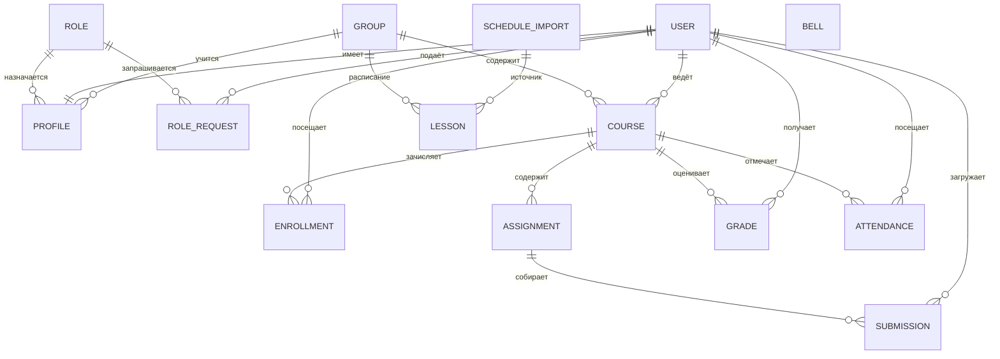

# База данных портала

СУБД: SQLite (файл `db.sqlite3`) для локального запуска; PostgreSQL — через `DB_ENGINE=postgres` и переменные `POSTGRES_*` (см. `.env.example`). Схема — Django ORM, миграции в `apps/*/migrations/`.

## ERD

## accounts

**Role** — роль и права. Поля: `code` (slug, уникальный), `name`, `description`, флаги `can_manage_users`, `can_manage_roles`, `can_approve_roles`, `can_manage_schedule`, `can_create_courses`, `can_grade`, `can_upload_works`, `can_view_all`, `is_developer`, `is_system`, `created_at`. `is_developer` обходит все проверки в `role_can()`; `is_system` защищает встроенные роли от случайного удаления (в админке).

**Profile** — OneToOne к `auth.User`: `role` (PROTECT), `group` (SET_NULL), `record_book`, `phone`, `birth_date`. Создаётся сигналом `post_save` при регистрации пользователя с ролью `student`.

**RoleRequest** — заявка на роль: `user`, `role`, `comment`, `status` (`pending/approved/rejected`), `created_at`, `reviewed_at`, `reviewed_by`, `review_comment`. Один пользователь может иметь много заявок, активная роль — одна.

## education

**Group** — `code` (уникальный), `program`, `course` (1–4), `institute`, `curator`.

**Course** — `title`, `code`, `group`, `teacher` (User), `semester`, `description`. Ограничение `(code, group)` уникально. При создании через интерфейс все студенты группы (роли student/monitor) зачисляются в `Enrollment`.

**Enrollment** — `course`, `student`, `enrolled_at`; уникальная пара.

**Assignment** — `course`, `title`, `description`, `due_date`, `material` (файл), `created_by`. Срок не блокирует загрузку — работа помечается как сданная, преподаватель видит дату.

**Submission** — `assignment`, `student`, `file` (`media/works/ГГГГ/ММ/`), `comment`, `submitted_at`, `status` (`submitted/reviewed/returned`), `grade`, `teacher_comment`, `reviewed_at`, `reviewed_by`. Уникальная пара `(assignment, student)`; повторная загрузка разрешена только после статуса `returned`.

**Attendance** — `course`, `student`, `date`, `status` (`present/absent/late/excused`), `marked_by`, `marked_at`; уникальная тройка `(course, student, date)` — повторная отметка обновляет запись.

**Grade** — `course`, `student`, `kind` (`exam/credit/coursework/test`), `value` (`5/4/3/2/зачтено/не зачтено`), `date`, `comment`, `created_by`. Уникальная тройка `(course, student, kind)` — одна итоговая оценка каждого вида на курс. Свойства `is_fail` и `numeric` используются для задолженностей и среднего балла.

## schedule

**Bell** — `building` (`1`/`2`), `pair` (1–6), `start`, `end`; уникальная пара `(building, pair)`. Время нормализуется из файла (`8.50` → `8:50`).

**ScheduleImport** — `file` (`media/schedule/`), `original_name`, `source_url`, `imported_by`, `imported_at`, `lessons_count`, `groups_count`, `note`. Каждый импорт создаёт запись; повторный импорт заменяет все занятия.

**Lesson** — `group`, `weekday` (1–6), `pair` (1–6), `week` (`all/odd/even`), `subject`, `kind`, `teacher_name`, `room`, `subgroup`, `source`. Индекс `(group, weekday, week)`.

## Инварианты и проверки

- Пароль демо-пользователей — `demo12345`; в проде — свои пароли и `DJANGO_SECRET_KEY`.
- Все изменяющие запросы — POST + CSRF; просмотр — только после входа (`login_required`).
- Права проверяются на сервере (`role_can`/`role_required`), а не только скрытием кнопок.
- Роль разработчика: выдача через заявку или карточку студента — только действующим разработчиком.
- Файлы работ: до 20 МБ, расширения `.pdf .doc .docx .zip .rar .txt .py .xlsx .png .jpg .jpeg`.
- Удаление курса каскадно удаляет задания, работы, оценки и посещаемость; удаление пользователя — профиль и зачисления, но не выставленные им оценки (`PROTECT` на `created_by`).
